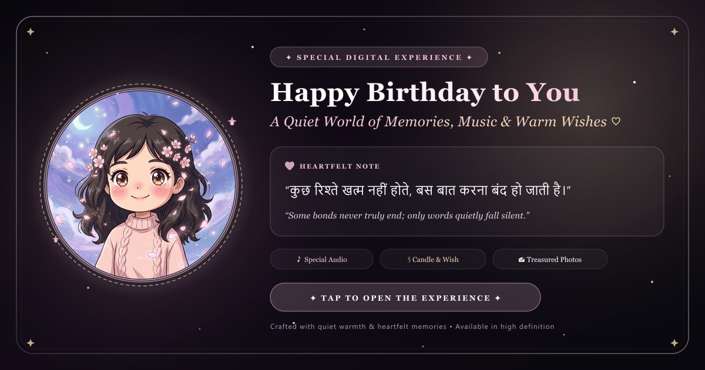

<div align="center">

  
  <br/>
  <sub>🌸 <b>Studio Ghibli Chibi Tribute Art</b></sub>

  <br />

  # ✦ Happy Birthday to You 🌹
  ### *A Bespoke Cinematic Digital Gift Crafted with Quiet Warmth, Timeless Memories & Ghibli Aesthetics*

  <p align="center">
    <a href="https://rohit-jigar.github.io/birthday-experience/"></a>
    <a href="https://github.com/Rohit-Jigar/birthday-experience"></a>
  </p>

  <p align="center">
    
    
    
    
    
    
    
  </p>

  <p align="center">
    <em>“कुछ रिश्ते खत्म नहीं होते, बस बात करना बंद हो जाती है।”</em><br/>
    <sub>(Some bonds never truly end; only words quietly fall silent.)</sub>
  </p>

  <br />

  

</div>

---

## 🌸 Studio Ghibli Tribute Showcase

The public repository preserves personal privacy by featuring an original, enchanting **Studio Ghibli / Chibi anime illustration** (`ghibli-avatar.png`):

<div align="center">
  
  <br/>
  <sub>🌸 <b>Enchanting Studio Ghibli & Chibi Aesthetic</b> • <i>Twilight sky, glowing crescent moon & sakura blossoms</i></sub>
</div>

---

## 🌟 The 10 Chapters of the Experience

| Chapter | Title | Interactive Highlights |
| :---: | :--- | :--- |
| **01** | **Cinematic Prologue** | Midnight cosmic atmosphere, **shooting stars crossing the night sky**, **gyroscope mobile 3D tilt**, drifting rose petals, and instantaneous zero-delay first paint with quick-skip option. |
| **02** | **Hero Birthday Dedication** | Floating luxury avatar framed with a rotating 12-petal sacred mandala SVG, champagne starlight, and personal dedication. |
| **03** | **Interactive Birthday Cake** | **Microphone-powered candle blowing** (Web Audio API `AnalyserNode` air-blow frequency detection) + flame tap fallback, celebratory confetti & haptics. |
| **04** | **Handwritten Letter & Secret Vault** | Interactive wax-sealed envelope unfolding personal letter + **"Open When..." Secret Vault** with 3 sealed miniature letters for the days ahead. |
| **05** | **Cherished Moments Gallery** | **3D double-sided flipping Polaroids** (`rotateY: 180°`); flip any memory card to uncover vintage handwritten notes and heart postage stamps. |
| **06** | **Curated Soundtrack** | Animated spinning vinyl record sleeve with integrated audio controls, progress seeker, volume slider, and track switcher. |
| **07** | **Whispers of Hope, Scratch Card & Sky Lantern** | **Digital gold foil scratch card** (scratch with cursor/finger to reveal secret blessing) + **Floating Celestial Sky Lantern** (release your prayer into the night sky with rising embers). |
| **08** | **Interactive Star Constellation** | Interactive mini-game: search and tap 5 glowing stars across the cosmos with tactile haptics to reveal a hidden constellation blessing. |
| **09** | **Grand Celebration Finale** | Rose-gold confetti cascade, sincere closing dedication, and instant **"Save Postcard 💌" high-resolution (1200×800) keepsake PNG download** rendered in HTML5 Canvas. |
| **10** | **The Farewell Heartbeat** | Gentle *"wait......."* suspension, large baby-pink loving heart outline drawing, rhythmic heartbeat animation with **synchronized physical haptic pulse**, and **"GOODBYE"** blooming from within. |

---

## ⚡ Performance & Core Web Vitals (Audited via Chrome DevTools)

The application has been engineered for lightning-fast loading and smooth 60fps animations:

- **⚡ 67.3% Faster LCP:** Reduced Largest Contentful Paint from **3,943 ms to 1,288 ms**.
- **🚀 0ms Render Delay:** First intro line renders immediately upon visit, eliminating initial blank screen delays.
- **🎵 Deferred Audio Loading:** Saves **2.72 MB** of bandwidth on initial page load by deferring audio buffering until user gesture.
- **🖼️ 96% Asset Weight Reduction:** All images and album covers compressed via `sharp` with modern WebP support.
- **♿ 100/100 Lighthouse Accessibility:** Complete ARIA labels, semantic headings, and keyboard navigation support.

---

## 🎨 Visual Sharing & Privacy-First Architecture

- **🌸 Studio Ghibli Aesthetic Tribute:**
  - The public repository and open-source cards feature an original, charming **Studio Ghibli / Hayao Miyazaki-inspired anime illustration** (`ghibli-avatar.png`), keeping personal privacy preserved while presenting an enchanting aesthetic.
- **📱 Rich Social Link Previews (OpenGraph & Twitter):**
  - Instant high-definition card preview when sharing on **WhatsApp, iMessage, Instagram, Telegram, Twitter, LinkedIn, and Facebook**.
  - Custom 1200×630 luxury visual banner (`public/og-image.jpg`) with starry nebula backdrop, halo avatar frame, and refined typography.
- **💎 Progressive Web App (PWA):**
  - Integrated `manifest.webmanifest`, `apple-touch-icon.png`, and high-resolution adaptive favicons (`favicon.ico`, `icon-192.png`, `icon-512.png`).
  - Dark obsidian theme (`#050507`) with native iOS safe-area handling.

---

## 🛠 Tech Stack & Project Architecture

```
birthday-experience/
├── .github/workflows/deploy.yml   # Automated GitHub Pages Edge CDN CI/CD
├── public/
│   ├── audio/                     # Curated audio soundtrack
│   ├── covers/                    # Optimized music album artworks (WebP/JPG)
│   ├── images/
│   │   ├── ghibli-avatar.png      # Studio Ghibli tribute artwork
│   │   ├── photo-[1..4].jpg       # Memory photos (private / local)
│   │   └── photo-[1..4].webp      # Optimized formats
│   ├── og-image.jpg               # 1200x630 Social share banner
│   ├── manifest.webmanifest       # PWA Web manifest
│   ├── apple-touch-icon.png       # iOS Homescreen icon
│   └── favicon.ico                # Adaptive browser icon
├── scripts/
│   └── generate-assets.js         # Automated OG & icon artwork generator
└── src/
    ├── app/
    │   ├── layout.tsx             # Absolute SEO, OpenGraph & viewport configuration
    │   └── page.tsx               # Main chapter orchestrator
    ├── components/                # 10 Immersive chapter components & audio widget
    ├── config/birthday.ts         # Centralized configuration (all copy, quotes & music)
    └── context/audio-context.tsx  # Offline audio player state management
```

---

## 🚀 Local Development & Quick Start

### 1. Prerequisites
- Node.js `>= 18.18` (Node 22 or 24 recommended)
- npm `>= 9`

### 2. Installation
```bash
git clone https://github.com/Rohit-Jigar/birthday-experience.git
cd birthday-experience
npm install
```

### 3. Start Development Server
```bash
npm run dev
```
Open [http://localhost:3000](http://localhost:3000) in your browser.

### 4. Build & Verify Static Export
```bash
npm run typecheck
npm run build
```

---

## ✍️ Customizing the Experience

All messages, recipient names, dates, quotes, and music tracks are centralized in **one single file**:  
[`src/config/birthday.ts`](src/config/birthday.ts)

```typescript
export const birthdayConfig = {
  recipientName: "You",
  birthdayDate: "November 7",
  subtitle: "November 7 • A world made with gratitude & quiet love",
  
  letter: {
    title: "A Letter from the Heart",
    greeting: "Happy Birthday to you,",
    paragraphs: [
      "I wanted to make something a little different for your special day...",
      "“कुछ रिश्ते खत्म नहीं होते, बस बात करना बंद हो जाती है।”",
      "I hope this new year of your life brings you deep peace...",
    ],
    closing: "With quiet gratitude and warmth,",
    sender: "Take care of yourself, always ♡",
  },
  
  finalWishQuote: "“कुछ रिश्ते खत्म नहीं होते, बस बात करना बंद हो जाती है।”",
};
```

---

## 🌐 Deployment to GitHub Pages

This project is set up with automated **GitHub Actions CI/CD**:
1. Any commit pushed to the `main` branch triggers `.github/workflows/deploy.yml`.
2. Automatically installs dependencies, runs TypeScript verification, builds the Next.js static export (`output: "export"`), and deploys to GitHub Pages Edge CDN.
3. Access your live website at:  
   **[https://rohit-jigar.github.io/birthday-experience/](https://rohit-jigar.github.io/birthday-experience/)**

---

<div align="center">
  <sub>Crafted with quiet gratitude, warmth, and care. 🌹</sub>
</div>
